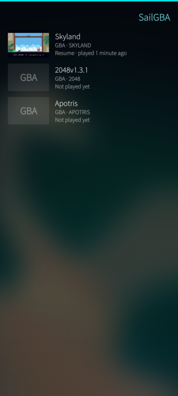
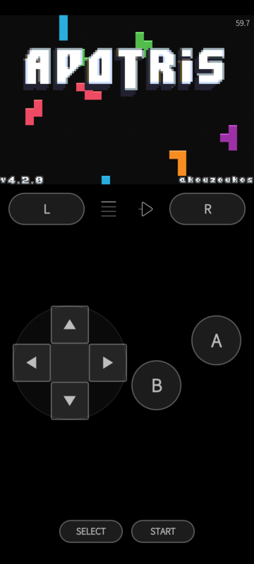
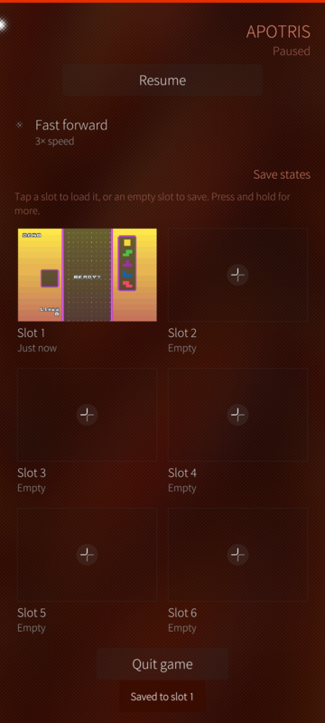
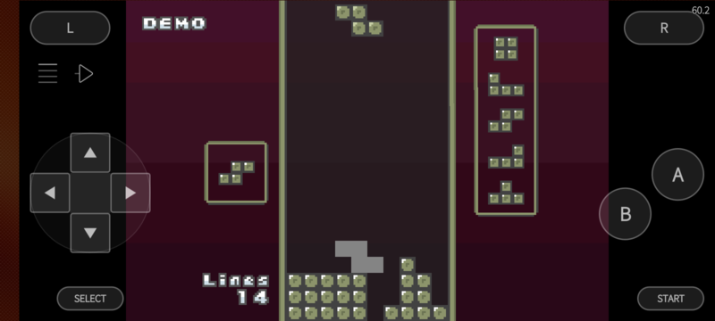

# SailGBA: mGBA Game Boy Advance emulator for Sailfish OS

[](https://github.com/HenriVSL/SailGBA/actions/workflows/build.yml)
[](https://github.com/HenriVSL/SailGBA/releases/latest)

SailGBA is a native **Sailfish OS** port of the [mGBA](https://mgba.io) emulator.
It plays **Game Boy Advance**, **Game Boy** and **Game Boy Color** games on Sailfish OS
phones such as the Jolla C2, Jolla Phone and Sony Xperia 10 series. It uses the
real mGBA core with a native Silica interface and on-screen multi-touch controls,
so it looks and works like any other Sailfish app. It does not run through Android
App Support.

<p>
  
  
  
</p>
<p>
  
</p>

## Features

- **mGBA 0.10.5 core** compiled into the app (GBA + GB/GBC), with no extra libraries.
- **Touch gamepad**: one multi-touch surface for all buttons. Slide between
  buttons, roll around the 8-way D-pad, or press A and B together with one thumb.
  Haptic feedback, adjustable size and opacity. Portrait and landscape layouts.
- **Game library**: finds `.gba`, `.gbc` and `.gb` files in Documents, Downloads,
  Android storage, memory cards and any folder you add. Shows the last screen
  you played as a thumbnail. You can also open any file from the pulley menu.
- **Resume where you left off**: the game state is saved automatically when you
  quit (also on SIGTERM) and restored next time.
- **Six save state slots** with screenshots, plus normal in-game (battery) saves.
  A `.sav` file next to the ROM is adopted the first time the game starts.
- **Fast forward** (2×, 3×, 4×, 8× or unlimited).
- **Live cover** showing the game, with a pause/resume cover action.
- Game pauses automatically when the app goes to the background; the display is
  kept on while playing.
- Optional **GBA BIOS** (dumped from your own console) for the original start-up
  logo and better compatibility; mGBA's built-in replacement is used otherwise.
- Rumble cartridges vibrate the phone. Hardware keyboards work too
  (arrows, X = A, Z = B, A/S = L/R, Enter = Start, Backspace = Select, Esc = menu).
- English and Finnish.
- Full speed (60 fps) on a Jolla C2 using about a third of one CPU core.

**No games or BIOS files are included.** Use your own cartridge dumps or free
homebrew games, for example from [itch.io](https://itch.io/games/tag-gameboy-advance)
or [gbadev](https://gbadev.net/).

### Known limitations

- Saves, states and thumbnails are named after the ROM file name without its
  extension (as mGBA does), so two games with the same name in different
  folders, or `Foo.gb` next to `Foo.gbc`, would share them.
- `.zip`/`.7z` archives are not opened (mGBA's archive support needs extra libraries).
- No link cable, cheats UI, rewind or tilt sensor yet.

## Install

Download the RPM for your device from
[the latest release](https://github.com/HenriVSL/SailGBA/releases/latest):

| RPM | For |
|---|---|
| `harbour-sailgba-<version>-1.aarch64.rpm` | 64-bit ARM phones: Jolla C2, Xperia 10 II and newer |
| `harbour-sailgba-<version>-1.armv7hl.rpm` | 32-bit ARM devices and 32-bit Sailfish OS installs |
| `harbour-sailgba-<version>-1.i486.rpm` | The Sailfish SDK emulator |

Not sure? Run `uname -m` in the Terminal: `aarch64`, `armv7l` (armv7hl) or `i686` (i486).
Requires Sailfish OS 5.1 or later.

Then either allow **Settings ▸ Untrusted software** and open the downloaded RPM, or, in
developer mode, run:

```sh
devel-su pkcon install-local ~/Downloads/harbour-sailgba-*.aarch64.rpm
```

Put your games in Documents, Downloads or on a memory card and they show up in the
library. See [docs/RELEASING.md](docs/RELEASING.md#installing-a-release-rpm) for details.

## Build from source

You need the [Sailfish SDK](https://docs.sailfishos.org/Tools/Sailfish_SDK/) with the
5.1.0.11 build targets, or just docker.

```sh
git clone https://github.com/HenriVSL/SailGBA.git
cd SailGBA
mkdir -p build-aarch64 && cd build-aarch64
sfdk -c target=SailfishOS-5.1.0.11-aarch64 build ..
```

Or with docker only: `.github/scripts/build-rpm.sh aarch64` (also `armv7hl`, `i486`).
See [docs/BUILDING.md](docs/BUILDING.md) for more, including the maintainer's
`sfdev` workflow.

## Layout

| Path | What |
|------|------|
| `src/emulator.*` | Runs the mGBA core on its own thread: loading, frame pacing, save states, auto-save. |
| `src/audiooutput.*` | QAudioOutput (PulseAudio) fed from a ring buffer; the emulator steers its resampling rate to keep latency low (dynamic rate control). |
| `src/gamescreen.*` | QQuickItem that draws the frame through a reused scene graph texture. |
| `src/romlibrary.*` | Game list model: background folder scan, cartridge header titles. |
| `src/settings.*` | Preferences (QSettings), BIOS import. |
| `qml/components/TouchControls.qml` | The on-screen gamepad and its hit testing. |
| `3rdparty/mgba/` | Unmodified mGBA 0.10.5 sources (only the parts needed). |
| `3rdparty/mgba.pri` | Builds the core with qmake; mirrors mGBA's CMake source list. |
| `tools/` | Device scripts: deploy, multi-touch injection (`sfinput`), unlock. |
| `.github/` | CI: builds the RPMs and publishes releases (see [docs/RELEASING.md](docs/RELEASING.md)). |

Data lives in `~/.local/share/io.github.henrivsl/harbour-sailgba/`
(`saves/`, `states/`, `thumbs/`, `bios/`, `settings.ini`).

### Updating mGBA

Replace `3rdparty/mgba` with the new release's `include/`, `src/` (core, gba, gb,
arm, sm83, util, feature, platform/posix, third-party/inih, third-party/blip_buf),
`LICENSE`, `README.md` and `CHANGES`, then compare the source list in
`3rdparty/mgba.pri` against a CMake `LIBMGBA_ONLY` build with the optional
dependencies switched off, and bump `3rdparty/mgba-gen/version.c` and the versions
in `THIRD_PARTY_NOTICES.md`.

## License

SailGBA is licensed under the Mozilla Public License 2.0, the same as mGBA.
mGBA is © Vicki Pfau and contributors; see `3rdparty/mgba/LICENSE`. Other bundled
code (inih, blip_buf) is listed in [THIRD_PARTY_NOTICES.md](THIRD_PARTY_NOTICES.md).

Game Boy and Game Boy Advance are trademarks of Nintendo. SailGBA is not affiliated
with or endorsed by Nintendo or the mGBA project.
